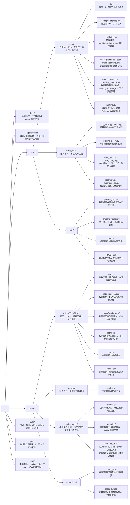

# CAE Bench

CAE Bench 用于评测 Agent 实现的计算工程求解程序。项目围绕通用数据协议、结构校验、测试数据和独立判分组织，支持持续增加不同物理模型的题目和测试。

考生阅读本题 `instruction.md`、`DATA.md` 和 [通用数据协议](docs/CONTRACT.md) 即可确定任务与数据规则。维护方可查阅 [题库设计](qbank/design/README.md)、[运行装配](qbank/maintenance/RUNTIME.md)、[评分配置](docs/GRADING.md) 及 [Agent 测试记录](docs/AGENT-RESULTS.md)。

本分支收录 [RC7 论文冻结快照](docs/releases/rc7-paper.md)的 82 题、647 个正式算例，其中 80 道计算题用于论文成绩。公开发行物为一个考生 ZIP。新增章节和论文范围外的题目在 `dev` 分支维护。

同一份 RC7 考生 ZIP 可从 [GitHub Release](https://github.com/AXeonV/CAE-Bench/releases/tag/caeoj-qbank-20261029-rc7)直接下载。也可登录 [Hugging Face 数据集 CAE-Bench](https://huggingface.co/datasets/jimzhouzzy2006/CAE-Bench)，获批访问后下载。两边的 ZIP 文件 SHA-256 相同。

## 设计

- **统一数据协议**：Gmsh 存网格，HDF5 存数组，JSON 声明字段和条件；题面与 DATA 明确本题任务及数据语义，求解程序按统一接口读写。
- **核心与领域扩展**：通用核心（`src/caeoj/`）负责读写、结构校验与评分编排，领域扩展（`qbank/extensions/`）提供声明检查及评价器；维护工具（`src/caeoj_tools/`、`src/utils/`）按题目依赖和白名单装配公开材料与必要工具。
- **做题时辅助校验**：Agent 可随时调用 SDK（`src/caeoj/sdk.py`）和**校验器**（`src/caeoj/validation.py`），减少数据读写与契约理解的负担；*校验器检查格式、引用及声明约束，不验证或纠正物理结果。*
- **提交后独立评测**：考生材料与私有判题材料分开装配；判题器（`src/utils/harbor/tests/judge.py`）在提交后逐 case 执行、校验并按本例规则评分，按逐例规则计分，汇总结果和日志。
- **数据与维护材料分存**：Hugging Face 的主分支分发论文冻结的考生包。正式输入、参考和逐例判分文件由维护者按冻结版本提供。题面、DATA、运行配置与工具代码保留在代码仓库。

## 项目结构

主要目录与入口如下，连线表示目录包含关系；题目内的作者工具、环境补充及专用扩展按需提供。

题目的开发材料与判题材料分别组织：开发材料提供题面、输入约定、公开样例及校验工具；判题材料包含测试数据、标答和判分配置。

## 任务

题目位于 `qbank/<章>/<节>/<题目>/`，具体题面、数据要求与准备方法见各题 README。

| 目录 | 内容 |
|---|---|
| [第 0 章](qbank/00-basic-tests/README.md) | 输入输出 smoke test |
| [第 1 章](qbank/01-prescribed-pdes/README.md) | 给定 PDE，包括自主设计题目与 PDEBench 数据适配 |
| [第 2 章](qbank/02-fluid-mechanics/README.md) | 流体力学 |
| [第 3 章](qbank/03-solid-mechanics/README.md) | 固体与结构力学 |
| [第 4 章](qbank/04-multibody-mechanics/README.md) | 多体力学 |
| [第 5 章](qbank/05-heat-transfer/README.md) | 传热与热过程 |
| [第 6 章](qbank/06-acoustics/README.md) | 声学分析 |
| [第 7 章](qbank/07-electromagnetics/README.md) | 电磁场与电路 |
| [第 8 章](qbank/08-optics/README.md) | 光学与光子学 |
| [第 9 章](qbank/09-species-reactions/README.md) | 组分传输与化学反应 |
| [第 10 章](qbank/10-electrochemistry/README.md) | 电化学分析 |
| [第 11 章](qbank/11-semiconductor/README.md) | 半导体与电子输运 |
| [第 12 章](qbank/12-granular/README.md) | 颗粒与散体力学 |
| [第 13 章](qbank/13-porous-media/README.md) | 多孔介质与渗流 |
| [第 14 章](qbank/14-plasma/README.md) | 等离子体与带电粒子 |
| [第 15 章](qbank/15-radiation-nuclear/README.md) | 辐射输运与核工程物理分析 |
| [第 16 章](qbank/16-microstructure/README.md) | 材料组织与微观演化分析 |
| [第 17 章](qbank/17-multiphysics/README.md) | 多物理场耦合 |
| [第 18 章](qbank/18-system-multidomain/README.md) | 系统级多领域分析 |

## 使用论文冻结快照

下载或取得按 [RC7 说明](docs/releases/rc7-paper.md)构建的公开考生 ZIP。考生解开所需题包，按题包 README 安装和开发。评测人员在独立环境中使用相应的正式输入、逐例判分配置和参考。

以 [冻结配置清单](release-patches/rc7-paper/PROFILE.json)和论文配套评测清单为准。HF 数据池的当前版本和仓库的通用开发命令适用于维护工作，复现实验应使用随冻结快照交付的文件与历史运行配置。

新章节、未入选题目以及作者工作流在 `dev` 维护。
