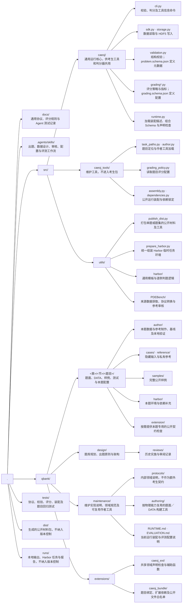

# CAE Bench OJ

CAE Bench OJ 用于评测 Agent 实现的计算工程求解程序。项目围绕通用数据协议、结构校验、测试数据和独立判分组织，支持持续增加不同物理模型的题目和测试。

考生阅读本题 `instruction.md`、`DATA.md` 和[通用数据协议](docs/CONTRACT.md)即可确定任务与数据规则。维护方可查阅[题库设计](qbank/design/README.md)、[运行装配](qbank/maintenance/RUNTIME.md)、[评分配置](docs/GRADING.md)及 [Agent 测试记录](docs/AGENT-RESULTS.md)。

## 设计

- **通用数据协议**：Gmsh 存网格，HDF5 存数组，JSON 声明字段和条件；各题目明确物理或数学问题与输入范围，求解程序按同一协议读写。
- **纠正 Agent I/O**：Agent 在理解输入、编写和调试程序时可随时调用**结构校验器**，根据诊断修改读写实现，减少输入输出理解错误的负担。*校验器检查格式、引用及声明约束，不验证或纠正物理结果。*
- **提交后独立评测**：逐例执行提交程序，重新校验输出并按题目误差阈值与标答比较，每点 0/1 分，汇总结果和日志。

## 项目结构

主要目录与入口如下，连线表示目录包含关系；题目内的作者工具、环境补充及专用扩展按需提供。



题目的开发材料与判题材料分别组织：开发材料提供题面、输入约定、公开样例及校验工具；判题材料包含测试数据、标答和判分配置。

## 任务

题目位于 `qbank/<章>/<节>/<题目>/`，具体题面、数据要求与准备方法见各题 README。

| 目录 | 内容 |
|---|---|
| [第 0 章](qbank/00-basic-tests/README.md) | 输入输出 smoke test |
| [第 1 章](qbank/01-prescribed-pdes/README.md) | 给定 PDE，包括自主设计题目与 PDEBench 数据适配 |
| [第 2 章](qbank/02-fluid-mechanics/README.md) | 流体力学 |
| [第 3 章](qbank/03-solid-mechanics/README.md) | 固体与结构力学 |
| [第 4 章](qbank/04-multibody-mechanics/README.md) | 多体力学 |
| [第 5 章](qbank/05-heat-transfer/README.md) | 传热与热过程 |
| [第 6 章](qbank/06-acoustics/README.md) | 声学分析 |
| [第 7 章](qbank/07-electromagnetics/README.md) | 电磁场与电路 |
| [第 8 章](qbank/08-optics/README.md) | 光学与光子学 |
| [第 9 章](qbank/09-species-reactions/README.md) | 组分传输与化学反应 |
| [第 10 章](qbank/10-electrochemistry/README.md) | 电化学分析 |
| [第 11 章](qbank/11-semiconductor/README.md) | 半导体与电子输运 |
| [第 12 章](qbank/12-granular/README.md) | 颗粒与散体力学 |
| [第 13 章](qbank/13-porous-media/README.md) | 多孔介质与渗流 |
| [第 14 章](qbank/14-plasma/README.md) | 等离子体与带电粒子 |
| [第 17 章](qbank/17-multiphysics/README.md) | 多物理场耦合 |
| [第 18 章](qbank/18-system-multidomain/README.md) | 系统级多领域分析 |

第 2～14、17～18 章已完成各自首版清单的题面、DATA 和评测配置；正式数值数据、参考及评测发布仍待完成。第 15、16 章仍处于总体规划阶段。逐章交付范围和证据见[题库设计](qbank/design/README.md)。

## 维护技能

Skill 是供维护 Agent 使用的工作流，位于 `.agents/skills/`，可在请求中指定技能名和目标，例如“使用 `$caeoj-design-data` 为 `<task>` 设计 DATA.md”。技能与引用说明随协议、工具和流程变更同步维护，不进入考生材料。

| 技能 | 用途 |
|---|---|
| [caeoj-author-question](.agents/skills/caeoj-author-question/SKILL.md) | 补齐单题／章节规划，撰写题面并协调独立设计、考生审阅 |
| [caeoj-design-data](.agents/skills/caeoj-design-data/SKILL.md) | 设计自包含 DATA.md，按需补足协议及工具支持 |
| [caeoj-manage-data](.agents/skills/caeoj-manage-data/SKILL.md) | 制作和上传 HF 题内数据池，选样、下载装配与完整性核验 |
| [caeoj-design-review](.agents/skills/caeoj-design-review/SKILL.md) | 独立检查问题族定位、能力划分、来源独立性与建模评价一致性 |
| [caeoj-candidate-review](.agents/skills/caeoj-candidate-review/SKILL.md) | 独立考生只读审阅题面与选定公开样例，支持题面／考试材料两种模式 |
| [caeoj-data-review](.agents/skills/caeoj-data-review/SKILL.md) | 对照题面、协议和全部实际数据，审核 I/O 定义与读取分支 |
| [caeoj-configure-judge](.agents/skills/caeoj-configure-judge/SKILL.md) | 配置评分与执行资源，核查判题实现并验证配置生效 |
| [caeoj-run-benchmark](.agents/skills/caeoj-run-benchmark/SKILL.md) | 准备并运行 Agent 评测，管理监控、冻结条件与结果汇总 |

## 运行

在本地或 HPC 执行主机的项目根目录操作，先激活自行配置的 Python 3.11+ 环境；`python`、`harbor` 和 `docker` 均使用该主机的安装。下述单行命令适用于 PowerShell 或 Bash，尖括号内容为待替换的占位符。

`<task>` 是稳定题目标识，例如 `heat-conduction-steady-2d`；`<task-dir>` 是实际目录，例如 `qbank/01-prescribed-pdes/1.1-elliptic/heat-conduction-steady-2d`。发布器与组装器通过标识定位题目，`--task` 不接受目录路径。

### 准备工作

**首次配置或依赖变化时安装环境。** Docker 使用 Linux containers，Agent 认证由执行主机配置。可在运行命令中追加 `--env-file '<agent-env-file>'`；Codex 的 `CODEX_AUTH_JSON_PATH` 指向自行配置的登录文件。

```sh
python -m pip install -e '.[maint,heat,pdebench]' -e qbank/extensions harbor
```

以上安装覆盖仓库维护及测试依赖，题目专用要求见本题 README。

**数据缺失或重新制作时准备数据。** 选择本题适用的一种方式；数据完整且与本次题目版本一致时可直接进入评测主线。

已有 `data-manifest.json` 的题目先执行 `python -m caeoj_tools.cli data assemble --task '<task>'`，按选样从 HF 获取并装配，再用 `data verify --task '<task>' --strict` 核验。制池、上传、选样及覆盖规则见[数据池操作](qbank/maintenance/DATA-SYNC.md)。发布和 Harbor 准备已接入离线前置检查。本地数据和回执由 Git 忽略；只有需要制作或修订数据时才使用下面的生成流程。

有独立生成器的题目生成输入、参考与公开样例：

```sh
python '<task-dir>/author/generate.py'
```

使用 PDEBench 来源数据的题目通过适配器获取、转换并审核：

```sh
python src/utils/PDEBench/prepare.py --tasks '<task>' --budget-gb 60 --no-bootstrap
```

`--tasks all` 准备该适配器支持的全部题目；具体来源、选样与参考证据保存在本题 `reference/`。数据来源不作为题目分类或题目 ID。参考精度及资源预算的校准状态见本题说明和[评测说明](src/utils/PDEBench/EVALUATION.md)。

### 评测主线

**1. 打包公开材料并统一组装 Harbor 环境。** 确认题面、DATA、完整公开样例、隐藏输入与参考均已就绪。评分由 `grading.json` 定义，逐例时限放在 `judge-config.json`，CPU／内存等容器资源放在 `harbor/task.toml`，依赖补充放在 `harbor/requirements.txt`。

```sh
python src/utils/publish_dist.py --task '<task>'
python src/utils/prepare_harbor.py --task '<task>'
```

`dist/<task>-agent.zip` 是考生可见的公开材料包，包含题面、DATA、通用协议、公开样例、评分配置、安装元数据及按题目装配的工具源码。题面和数据由出题阶段提供；发布器收集这些材料并装配工具，不自动撰写 DATA。Harbor 构建镜像时安装包内工具，考生直接使用。

临时任务位于 `runs/harbor/tasks/<task>/`，隐藏输入和私有参考仅进入独立判题环境。协议、工具、材料或配置改变后重新打包并组装；已有产物内容匹配时可复用。首次验收或判题实现变化时，可先做下方的 Oracle 检查。

**2. 启动监控。** 另开终端，在同一执行主机、同一项目目录启动 Viewer，保持运行：

```sh
python -c "from pathlib import Path; Path('runs/harbor/jobs').mkdir(parents=True, exist_ok=True)"
harbor view 'runs/harbor/jobs' --jobs --host 0.0.0.0 --port 8080
```

本机访问 `http://127.0.0.1:8080`；远程执行时使用执行主机的可达地址。确认页面可用，再运行 Agent；Viewer 与运行命令须使用相同 jobs 目录。

**3. 运行 Agent 并独立判题。** 例如 Codex + Luna，独立尝试一次、并发一个 trial：

```sh
harbor run -p 'runs/harbor/tasks/<task>' -e docker -a codex -m 'openai/gpt-6-luna' --ak 'reasoning_effort=medium' -k 1 -n 1 -o 'runs/harbor/jobs'
```

HPC 可追加 `--override-cpus '<cpu-quota>' --override-memory-mb '<memory-mb>'`，资源值与组装时的声明保持一致。`-k` 控制独立尝试次数，`-n` 控制并发 trial 数；单个求解器的线程或 MPI 进程数由程序在可用 CPU 配额内选择。

默认镜像提供 g++、OpenMP、Open MPI 和 HDF5 开发库（`h5cc`／`h5c++`、`h5dump`），解题与独立判题容器共用该工具链；GPU 需另行配置。

**4. 汇总结果。** 通过 Viewer 查看运行状态；各 trial 的 `verifier/report.json` 保存逐例状态、得分及误差，`reward.txt` 保存通过率。确认全部计划 trial 和测试点已完成，区分求解器失败与输入、参考、配置等基础设施错误。

可使用 [caeoj-run-benchmark](.agents/skills/caeoj-run-benchmark/SKILL.md) 让维护 Agent 执行就绪检查、冻结条件、组装、监控与结果汇总。配置消费点、总预算及数据就绪要求见[维护说明](qbank/maintenance/EVALUATION.md)。

### 按需验证与诊断

**开发回归：题目或基础设施修改后、打包前执行相关测试。** `<test-file>` 取对应题目 README 中的文件；全量回归前补齐各相关测试依赖的本地数据。

```sh
python -m unittest discover -s tests -p '<test-file>.py' -v
python -m unittest discover -s tests -v
```

基础读写链路可用 `python -m caeoj_tools.cli smoke` 检查，详见[基础测试说明](qbank/00-basic-tests/README.md)。

**结构诊断：定位输入或输出问题时执行。** 发布和组装内部已有结构检查，以下单点命令供调试使用，无需每轮手工重复。

```sh
python -m caeoj validate-input '<task-dir>/cases/<case>/problem.json'
python -m caeoj validate-output --input '<task-dir>/cases/<case>/problem.json' --output '<task-dir>/reference/<case>/reference.h5'
```

**Oracle 检查：有 baseline 时验证容器与判题链路。** 在组装后、Agent 评测前按需运行；组装结果的 `oracle_available` 为 false 时跳过。

```sh
harbor run -p 'runs/harbor/tasks/<task>' -e docker -a oracle -k 1 -n 1 -o 'runs/harbor/jobs'
```

**单点复核：检查已有求解程序的输出和成绩。** 判分会独立校验输出结构，数值规则使用本题 `grading.json`。

```sh
python '<solver.py>' --input '<task-dir>/cases/<case>/problem.json' --output 'runs/<task>/<case>/result.h5'
python -m caeoj grade --input '<task-dir>/cases/<case>/problem.json' --output 'runs/<task>/<case>/result.h5' --reference '<task-dir>/reference/<case>/reference.h5' --grading '<task-dir>/grading.json'
```

校验返回 `valid/errors` JSON；判分每点为 0/1，退出码 2 表示基础设施或命令参数错误。评分方式见 [GRADING.md](docs/GRADING.md)。
