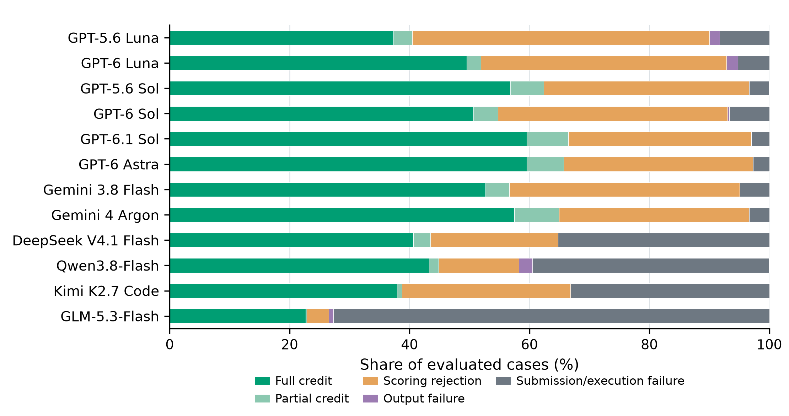

# CAE-Bench

**A benchmark for AI agents that build reusable engineering simulation solvers.**

[Download RC7](https://github.com/AXeonV/CAE-Bench/releases/download/caeoj-qbank-20261029-rc7/caeoj-qbank-rc7-paper-public.zip) · [Hugging Face](https://huggingface.co/datasets/jimzhouzzy2006/CAE-Bench) · [Results](#results) · [Quick start](#quick-start) · [Evaluation protocol](#evaluation-protocol)

## Overview

Can an agent write a solver that works when the geometry, material properties, or boundary conditions change? In CAE-Bench, an agent receives a task specification, an input/output contract, and public cases. It submits one solver per task. A separate evaluator runs that solver on the task's cases, including held-out inputs, and scores its numerical outputs against reference solutions.

**RC7** is the frozen snapshot behind the paper's results. It contains **82 tasks and 647 formal cases**. The paper reports scores on **80 computational tasks and 630 cases**, covering prescribed PDEs, fluid mechanics, and fixed-problem tasks. The other two tasks check benchmark infrastructure. Browse the [frozen task and runtime profile](releases/rc7/PROFILE.json) for the full scope.

## Results



*Figure 3 from the paper. Each bar shows the share of evaluated cases for one model setting. The headline score averages cases within each task, then weights tasks equally.*

In the paper's representative comparison, GPT-6.1 Sol and GPT-6 Astra scored **65.24** and **64.85** overall, respectively. Both scored **100.00** on the 24 fixed-problem tasks. On tasks with varying physical inputs, their scores were **50.35** and **49.79**.

## Quick start

**1. Download the public task archive.** The [GitHub Release](https://github.com/AXeonV/CAE-Bench/releases/tag/caeoj-qbank-20261029-rc7) offers a direct download. The [Hugging Face mirror](https://huggingface.co/datasets/jimzhouzzy2006/CAE-Bench) hosts the same ZIP and requires approved access. The release page lists the SHA-256 checksum.

**2. Open a task.** With Python 3.11 or later, start with steady heat conduction:

```sh
python -m zipfile -e caeoj-qbank-rc7-paper-public.zip rc7
python -m zipfile -e rc7/public/heat-conduction-steady-2d-agent.zip heat-conduction
cd heat-conduction
python -m pip install .
```

**3. Validate a public input.** Read the task's `instruction.md` and `DATA.md`, then try the bundled validator:

```sh
python -m caeoj validate-input qbank/01-prescribed-pdes/1.1-elliptic/heat-conduction-steady-2d/samples/01/input/problem.json
```

Each task package includes setup instructions and format examples. The examples illustrate the required file structure. The validator checks the data contract. Numerical evaluation uses the frozen reference outputs.

## Evaluation protocol

The public archive contains candidate materials. Formal evaluation requires the matching frozen inputs, references, and grading files from the maintainers. The evaluator runs the submitted solver separately from the agent's development environment. RC7 uses RMS NRMSE for its computational cases and permits partial credit. See the [RC7 release guide](docs/releases/rc7-paper.md), [data contract](docs/CONTRACT.md), and [grading specification](docs/GRADING.md) for details.

## Repository and citation

- [`qbank/`](qbank/) contains the task specifications and data contracts.
- [`src/caeoj/`](src/caeoj/) contains the validation SDK and grading engine.
- [`releases/rc7/PROFILE.json`](releases/rc7/PROFILE.json) records the frozen task set and evaluation settings.

If you use CAE-Bench in research, cite Zhiyu Zhou et al., *CAE-Bench: Benchmarking AI Agents for Reusable CAE Solver Development*. The repository code is licensed under [Apache 2.0](LICENSE). Consult the terms bundled with each task for its assets.
