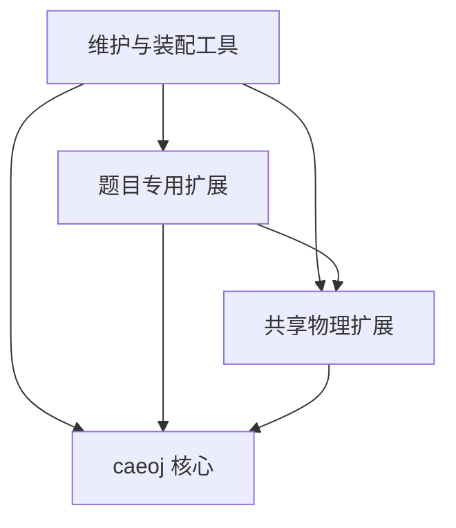

# 核心、题库扩展与维护工具的职责设计

日期：2026-10-16。状态：职责与迁移归属设计，尚未实施代码迁移。

本设计依据当前 `src/caeoj` 的全部 19 个源文件／Schema、公开包发布器、Harbor 组装器及其调用方梳理。目标是使新增题目主要修改题库，新增物理能力主要修改共享扩展，通用表示或扩展接口确有缺口时才修改核心。目录归属不能改变题面、DATA、数据解释或评分行为。

## 一、四类职责

| 类别 | 拥有的职责 | 边界与使用方 |
|---|---|---|
| 核心 `src/caeoj/` | 通用文件与数组读写；输入对象、引用、位置、时间、分量及输出结构；通用诊断；通用评分策略与指标；扩展接入接口 | 不知道章号、题号、题库目录和具体物理模型；可以独立安装。领域检查通过显式传入或装配的扩展集合调用，核心不维护物理模型分支 |
| 共享扩展 `qbank/extensions/` | 一类物理声明的 Schema、单位／参数／条件组合检查、显式采样适配及公开辅助函数 | 按物理能力复用，可跨章、跨题使用；依赖核心或显式声明的其他扩展；不读取题目目录、不根据章号启用，不生成参考解或选择考生闭合模型 |
| 题目专用扩展 `<task>/extension/` | 不能合理复用、且必须运行才能完成该题契约检查或现有通用评分机制不能表达的公开规则的代码 | 只在确有代码需求时建立。范围、依据和依赖必须明确；不能代替 DATA、加入隐藏限制或藏标答。普通参数差异、阈值和资源限额使用数据／配置，不为每题造扩展 |
| 维护工具 | 题目发现、配置装配、公开包制作、运行后端、数据获取／生成、参考制作、审计和报告 | 共用部分归 `src/caeoj_tools/`，题目专属部分归 `<task>/author/`。当前 `src/utils/` 入口后续可保留薄包装。维护工具调用核心与扩展，核心与扩展不反向依赖维护工具 |

共享扩展与题目扩展是受维护方控制的运行代码，不是考生可提交的插件。输入数据不能指定任意 Python 文件、导入路径或下载来源；装配器只从可信配置选择已登记的扩展。扩展缺失或冲突应明确失败，不能静默跳过检查。

题目专用扩展包含的是契约规则实现；生成输入、制造参考、参考求解器及特定来源适配属于维护工具。评测时参考数据可以私有，但评价规则必须在题面公开。需要自定义指标时先判断是否是可复用通用指标，不能把整个 judge 搬进每题。

公共工具属于可选实现辅助，考生阅读集合仍是本题 instruction.md、DATA.md、通用 CONTRACT.md。任何运行扩展不得成为额外题意来源，也不要求考生使用 Python SDK 求解。

## 二、目标目录与物理归属

以下是归属结构，不要求立刻创建所有子包。`caeoj_ext` 与 `caeoj_tools` 是计划采用的独立导入命名空间，后续需配置安装与资源打包，不能依赖仓库当前工作目录碰巧可导入。

```text
src/caeoj/                         通用运行核心
src/caeoj_tools/                   共用维护工具
src/utils/                        现有命令入口，迁移期间可作薄包装
qbank/extensions/caeoj_ext/
    fluid/
        single_phase/             单相流体声明、材料、条件
        thermal_flow/             流动中的热效应及相关声明
        turbulence/               湍流方法、统计目标与相关声明
        multiphase/               多相、分散相及相间过程
        thin_film/                薄膜与润滑流动
        depth_averaged/            深度平均与分层流动
        rarefied/                 滑移及稀薄气体声明
        complex_fluid/            黏弹、触变及相关材料记忆效应
qbank/<chapter>/<section>/<task>/
    extension/                    按需存在的题目专用运行代码
    author/                       题目专用维护代码
```

这些名称表示代码能力，不对应固定节号；重排章节不得改扩展标识。共享扩展不以 `chapter_02`、`section_2_1` 或来源软件命名。纯流体热效应暂归 fluid；以后出现多个领域实际复用的材料或热力学能力时，再提取共同模块，并保留各领域的声明适配，不预先复制或铺满所有 CAE 领域。

`thermal_flow` 与 `turbulence` 应拆开拥有热物性和统计／方法语义，但两者可以通过显式组合共同支撑一个模型，不能形成循环依赖。`complex_fluid` 中可复用的黏度响应可与 `single_phase` 共享；不应复制同一本构实现。

扩展之间优先组合与明确依赖；核心只提供数据与检查接口，不建立覆盖全部物理的继承树。确切注册 API、扩展清单格式和安装布局在下一步接口设计中确定。

## 三、当前逐模块依赖与迁移归属

下表列出当前直接项目内依赖，包含函数内延迟导入；省略标准库与第三方库。这里记录的是现状，目标依赖方向见下一节。

| 当前文件 | 当前直接内部依赖／职责混合 | 目标归属与处理 |
|---|---|---|
| `__init__.py` | 包说明，无内部依赖 | 留核心，维持通用入口 |
| `__main__.py` | `cli.main` | 留核心，只进入通用 CLI |
| `cli.py` | grading、grading_policy、validation；按模块存在性加载 examples、smoke；硬编码第 0 章路径 | 拆分：校验／判分入口留核心；make-cases、smoke 及仓库路径默认值移维护命令；不再以模块是否存在决定核心命令集合 |
| `storage.py` | HDF5 数组读写，无内部依赖 | 留核心，保持 dtype、shape 与值不被修复 |
| `validation.py` | storage；延迟导入 cfd、fluid_energy、fluid_multiphase、fluid_reduced；同时承担对象、网格读取、通用检查、流体分派 | 拆分：通用对象／诊断／检查留核心；物理模型识别、CFD 特例及领域检查迁扩展；网格资源需求由扩展声明，移除按流体前缀决定加载的逻辑 |
| `problem.schema.json` | 通用结构与 cfd_* 定义混合；根 profile 固定 cfd-2.1；allOf 包含流体启用和互斥逻辑 | 拆分：通用结构留核心，CFD 声明及领域组合约束迁对应扩展 Schema。装配完整 Schema 后仍严格拒绝未知键，不能靠放开 additionalProperties 完成迁移 |
| `sdk.py` | storage、validation；延迟导入 cfd、mesh_geometry、三个 fluid_* 模块；包含领域计算与条件适配 | 拆分：通用读取／写入、IDs、明确的通用时间采样留核心；压力解释、材料响应、领域条件适配和统计计算迁共享扩展；旧导入兼容作为迁移期适配，不留永久领域实现 |
| `mesh_geometry.py` | 无内部依赖；当前几何函数内含单一面连通域要求、支持单元限制和 CFD 错误信息 | 拆分：中性的一阶网格邻接／度量／法向／平移配对原语留核心几何模块，显式保留支持范围；流体域连通、边界覆盖及物理用途限制归流体扩展。不能整文件换名后称为通用 |
| `cfd.py` | mesh_geometry；延迟依赖 validation.issue、sdk.condition_values | 迁 `fluid/single_phase`；拆声明检查与材料辅助；反向依赖 sdk 的流体条件处理迁到扩展内部，通用采样原语仍调用核心 |
| `fluid_energy.py` | mesh_geometry；validation.issue；热效应与湍流统计／方法检查混合 | 拆入 `fluid/thermal_flow`、`fluid/turbulence`；共享检查与组合适配显式复用；暂保留旧模型标识，不由文件移动修改闭合责任 |
| `fluid_multiphase.py` | validation.issue、mesh_geometry；模型表、参数／初态／输出检查、相质量辅助 | 迁 `fluid/multiphase`；按实际依赖组织子模块，相间热过程允许依赖热物性能力，不因来自同一节而独立复制 |
| `fluid_reduced.py` | validation.issue、mesh_geometry；薄膜、深度平均、稀薄气体、复杂流体混在 MODELS；模型记录带 section | 分拆至 thin_film、depth_averaged、rarefied、complex_fluid；移除 section 元数据，模型路由由可信注册描述拥有；Maxwell 分布、黏度响应和分层特征速度分别随物理能力迁移 |
| `grading_metrics.py` | 无内部依赖，通用数组误差／聚合计算 | 留核心；只解释明确策略，不猜压力、相或具体物理量 |
| `grading_policy.py` | Schema 校验、quantity／单位绑定、输入参数偏置绑定、策略呈现；task_policy 读取题目文件并延迟反向导入 grading 容差 | 拆分：策略解析、校验、显式绑定、呈现及哈希留核心；题目目录和 judge-config 读取迁共用维护层。整理默认容差拥有位置，消除 policy 与 grading 的回调环 |
| `grading.schema.json` | 通用指标、聚合、阈值和显式偏置结构 | 留核心；物理题目的具体量名、阈值和值不写入该 Schema |
| `grading.py` | grading_policy、grading_metrics、sdk、validation | 留核心。继续接收给定输入、输出、参考和策略，不定位题库、不执行求解器；通过装配上下文使用契约扩展 |
| `task_paths.py` | 无内部依赖；按 qbank 三层目录和唯一 slug 查题，拒绝链接 | 迁共用维护层。题目发现不是数据协议能力；公开工具不需要仓库目录解析 |
| `examples.py` | storage、validation 的 Gmsh 锁、网格读取与 JSON 写入；生成固定 smoke 案例 | 迁 smoke-test/author；CASE_NAMES、固定数值与生成逻辑随题维护。若其中网格构造器确有其他调用，提取测试／维护 helper，不放回核心 |
| `smoke.py` | grading、grading_policy.task_policy、sdk、validation；检查 task=smoke-test，以输入构造参考，执行程序并汇总 | 迁 smoke-test/author；通用执行需求以后由共用 runner 承担，smoke 特有参考与身份检查仍归本题，不把原 runner 原样提升为通用 |

### SDK 内部边界

- 留核心：load_problem、load_result、read_constant、read_field、write_result、target_ids、id_to_row、read_option；sample_field 的显式时间采样。采样能力是否适用由声明和扩展检查保证，不推断缺省物理意义。
- 拆成中性原语与领域包装：boundary_geometry、boundary_integral、periodic_face_pairs、condition_values。几何度量与数组加权可通用；二维流量／力的单位厚度解释、区域兼容规则及周期条件键约定属于相应扩展。节点平均只适用于已声明的重建，不能升级为无条件通用算法。
- 迁共享扩展：absolute_pressure、fluid_material、density_at_pressure、dynamic_viscosity、全部 fluid_energy_*、multiphase_*、reduced_*、maxwellian。这些函数是显式辅助，不是考生必须采用的算法；是否继续公开及公开接口在迁移时逐项确认。

### Schema 与校验器的隐藏耦合

当前除了 check_problem 的领域分派，Checker.conditions 也根据 cfd-2.1 允许条件的节点场覆盖单元区域；read_mesh 的 geometry 参数由流体标识触发。因此仅迁出 check_cfd 等函数仍会保留耦合。领域必须能声明所需网格信息及合法引用关联，核心执行中性检查，领域判断具体关联是否满足契约。

Schema 拆分还须覆盖当前根 contract_version／profile／analysis／materials 成组出现、physics 流体模型与这些键互斥，以及条件数据空对象的不同允许规则。通用 sampling、aggregate 和类型化引用跨领域成立，保留在核心；每个物理模型允许哪些采样、聚合和条件组合归扩展。

## 四、依赖方向与装配边界



图中箭头表示代码依赖。核心通过通用接口调用装配好的检查器，不导入具体物理扩展；运行时回调不等于核心拥有物理依赖。共享扩展之间允许有向无环依赖，题目扩展不能成为共享扩展的依赖。

运行装配至少要明确：扩展身份与版本、依赖集合、Schema 资源、检查入口、网格需求、可选公开辅助接口和发布文件范围。接口的确切字段本轮不定，但不能把全部行为塞进一个没有边界的回调。核心先完成必要结构检查；扩展得到已满足先决条件的对象，错误路径与类别保持可审计。

同一求解器覆盖多题时，由装配层合并各题依赖，检查冲突；目录编号不参与语义。缺少所需扩展属于工具／装配错误；输入违反已经加载的契约属于输入错误，不能与考生数值答案错误混淆。

## 五、发布器及仓库外调用方

| 调用方 | 当前依赖 | 计划归属与影响 |
|---|---|---|
| `src/utils/publish_dist.py` | task_paths、sdk、grading_policy.task_policy、validation；TOOL_FILES 硬编码所有流体模块 | 共用维护层。消费装配清单，打包核心、所需公开扩展和公开题目材料，不列举物理模块名；新增已支持类型的题目无需修改它 |
| `src/utils/prepare_harbor.py` | publish_dist 的 collect_materials／文件读取，task_paths、sdk、grading_policy | 共用维护层及后端适配。与发布器共享装配结果；公开与私有材料分别收集，隐藏案例、参考及 author 不进入考生包 |
| `src/utils/PDEBench/prepare.py` | task_paths；来源选择与转换 | 来源维护工具，迁移 import；不作为通用核心或物理扩展的依赖 |
| `src/utils/make_cfd_examples.py` | cfd.material_density | 示例制作维护工具，改为导入共享扩展；不因使用材料函数就将生成器放进扩展 |
| `tests/` | examples、smoke、task_paths、各领域模块，以及部分测试从 smoke 导入 PROJECT_ROOT | 按新归属更新测试。通用测试根路径由测试 helper 拥有；通用契约 fixture 留测试层，不要求已安装核心自带 smoke 生成器 |
| `pyproject.toml` | 当前只打包 caeoj 和两个 Schema | 后续显式配置核心／扩展／维护包的安装与资源范围，独立解压包验证；仅移动 Python 文件不能完成可安装性 |

运行扩展与维护文件的公开性由装配清单明确声明，不能递归复制整个 extension 或 author 目录。候选环境与 verifier 使用相同版本的契约实现；二者可见数据不同。规则实现的公开与私有运行文件需要逐项区分，不能只因判题会用到就全部公开。

## 六、兼容与后续实施条件

1. 本轮只新增设计，不移动源文件、不更改题面、DATA、Schema、评分配置或 skill。下步先设计扩展接口与装配清单，再迁实现；题目专用 extension 不批量创建。
2. 现有 cfd-2.1 和 fluid-* 模型标识保留为输入兼容标识。特别是 cfd-2.1 虽含节号，也不能直接替换已有数据；注册描述将它映射到物理扩展。未来中性标识若涉及数据契约变化，单独定义版本与迁移，不能顺带改写冻结清单。
3. 当前 fluid_reduced.MODELS 的 section 未见运行时取用；迁移前仍需核对新调用与测试。章节归属保留在题库规划中，不成为运行注册信息。
4. 旧 caeoj.cfd、caeoj.fluid_* 和领域 SDK 导入如需兼容，只保留有期限及范围记录的转发。最终核心独立安装不得强制依赖题库扩展；兼容包的交付方式在接口实施时确定，不能反向常驻核心。
5. 通用 Schema 的严格性、旧合法输入、非法诊断、领域辅助值、输出结构和评分结果均需验证；源码导入可行不能代替独立包验证。核对公开包没有私有参考、隐藏数据及维护文档。
6. 后续再修订 author-section、design-data、configure-judge 的职责：新增题目默认不改核心和发布器；扩展不足先补物理扩展；通用表示／接口不足才改核心。skill 应指向实施后的实际接口，不提前宣称本设计已运行。

本次核查是依赖与职责审查，不提供新的数值／物理验证，也不改变此前记录的数据缺口与预算校准状态。
