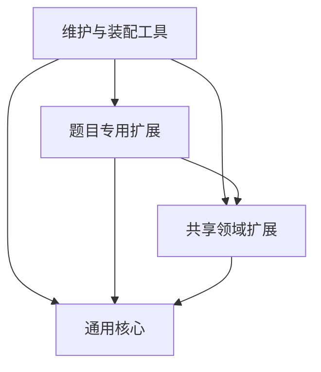

# 核心、题库扩展与维护工具

本文描述当前职责与依赖边界。公开交付约定见[公开接口设计](PUBLIC-INTERFACE.md)，注册字段和操作方法见[运行装配维护说明](../maintenance/RUNTIME.md)。

## 职责

| 位置 | 职责 |
|---|---|
| `src/caeoj/` | 通用文件、数组、对象、引用、位置、时间和分量；Schema、诊断、基础 SDK、中性几何原语、case 评价编排、中性观测提取、数值评分与扩展调用接口 |
| `qbank/extensions/caeoj_ext/` | 共享领域声明检查、可信领域评价器及可选辅助函数；只实现题面和 DATA 已公开的约束，不补充题意或制作参考解 |
| `<task>/extension/` | 按需提供不可合理复用的题目契约检查；普通参数、阈值和资源差异不需要新增模块 |
| `src/caeoj_tools/` | 题目定位、作者工具加载、评分配置读取、依赖锁定和公开运行装配 |
| `src/utils/` | 发布、Harbor 后端、来源适配器及其命令入口 |
| `<task>/author/`、`qbank/maintenance/` | 数据与参考制作、来源审核、维护示例及内部说明，不进入公开解题包 |

核心不认识章号、目录名或具体物理模型，也不定位题库、生成数据或执行求解器。共享扩展按物理能力组织，章节重排不改变其标识。当前包括流体、固体、多体、热学、声学、电磁、光学、组分反应、电化学、半导体、颗粒、多孔介质、等离子体、辐射／核工程、材料组织、连续体耦合与系统网络；流体内部按单相、热效应、湍流、多相、薄膜、深度平均、稀薄气体及复杂流体拆分。

## 依赖与检查

箭头表示代码依赖。核心通过通用接口调用已装配的检查器，不维护物理分支；扩展间只允许显式、无环的依赖。共享扩展不读取题目目录，也不反向依赖维护工具或题目扩展。

通用结构与引用检查先运行；扩展再接收已满足先决条件的问题对象，检查公开的单位、参数、采样和条件组合。扩展可声明所需几何信息和条件位置关联规则，不能要求核心按某个物理前缀走特殊分支。检查均不求解 PDE、不纠正数值、不证明参考解正确。

Schema 组合保持严格未知键检查。扩展不能覆盖核心或其他扩展的定义；确需改变约束时，只能使用核心明确开放的扩展点。新增物理能力优先修改共享扩展；只有通用表示或接入接口确实不足时才修改核心。

## 装配

可信注册描述位于 `qbank/extensions/caeoj_bundle/runtime.json`。每题显式绑定所需扩展，空列表表示只需要通用结构检查。题目专用扩展使用本题 `extension/runtime.json`；输入文件不能指定代码路径或插件。

`caeoj_tools.assembly.runtime_materials` 求依赖闭包，检查资源、版本和 Schema 冲突，按白名单收集核心及必要扩展，生成单次安装元数据和严格题目绑定。发布与 Harbor 共用这一结果；隐藏测试、私有参考和作者工具由后端另行收集。

case 只通过 evaluator 标识选择已装配实现，不能提供可执行代码或导入路径；领域评价实现进入共享扩展，阈值、测点、参考和评价计划随 case 进入 HF。注册接口及证据见[判题说明](../../docs/GRADING.md)。

运行时只读取已安装的固定 provider 包资源，不扫描工作目录寻找扩展。未装配的题目或缺失的支持属于工具错误，不能降级成通用结构通过。独立核心可以安装，但其检查范围必须明确标为通用结构。

## 公开接口与维护边界

完整仓库安装的 `caeoj data` 入口按需委派到 `caeoj_tools.data_cli`；章节定位、清单、外部存储与装配均留在维护包。公开装配不包含该包、数据锁或来源配置，校验与评分不依赖下载工具；在仅公开工具环境调用数据命令时给出需要完整仓库的诊断。

基础 SDK 保持 `caeoj.sdk` 入口。已经被题目使用的领域 SDK 名称及 `caeoj.cfd`、`caeoj.fluid_*` 导入由装配描述转发到共享扩展；转发层只适配接口，不复制物理实现。纯核心不因此依赖所有领域。

发布器只处理题目材料、文件白名单和装配结果，不列举物理模块。Harbor 组装器处理模板、资源、受信任 judge 与私有数据；来源下载、数据生成和参考制作不属于二者。

变更需验证非法输入、基础接口、领域转发、独立公开闭包及相关评分回归。普通安装、移走源码后的运行和目标平台执行分别验证；临时 fixture 通过不代表正式数据、参考精度或资源预算已就绪。历史实施证据保留在 [reviews](reviews/runtime-refactor.md)，不作为当前接口定义。
